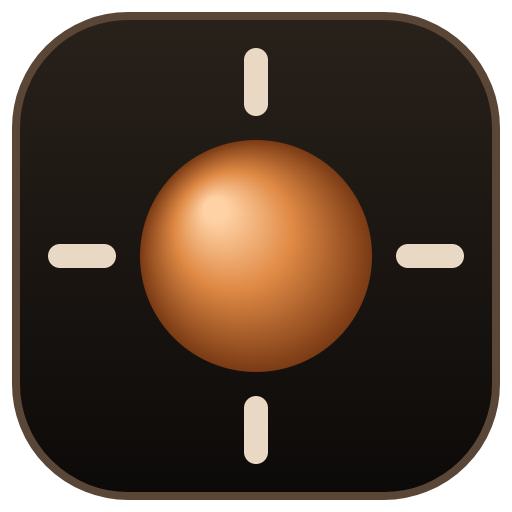

<p align="center"></p>

# Keel

Keel finds out whether your flicks land long or short in some directions, and evens that out in [RawAccel](https://github.com/RawAccelOfficial/rawaccel) one direction at a time. Your overall sensitivity and your accel curve stay as they are.

You flick at targets in a 3D range set up with your game's sensitivity, DPI, and field of view. Keel measures how far each flick goes compared with where the target was, separately for right, left, up, and down. When one direction is clearly off, it sends a small step to RawAccel's left, vertical, and up multipliers.

## Install

1. Download `Keel-Setup-x.y.z.exe` from [Releases](../../releases) and run it. The installer is not code-signed yet, so Windows SmartScreen may warn you: choose **More info → Run anyway**.
2. Open Keel. If the RawAccel driver is not installed, click **Install RawAccel driver**, accept the administrator prompt, and restart the PC.
3. If you already use RawAccel, click **Import RawAccel settings…** and pick your `settings.json` (next to `rawaccel.exe`) **before** applying a step. Otherwise Keel starts from RawAccel's defaults, and applying a step replaces what RawAccel is using now.

Keel ships the official, unmodified RawAccel 1.7.1 runtime (`writer.exe`, the driver, and its installer) under RawAccel's MIT license. The build downloads it from RawAccel's GitHub release and checks it against the published SHA-256.

## Using it

- **Setup:** pick your game and enter your in-game sensitivity, DPI, and field of view. Keel shows the resulting cm per 360°, including RawAccel's current sensitivity.
- **Rounds:** play 16 or 40 flicks, then look at the landing chart and apply the suggested step. Play another round to see whether it helped.
- **Continuous:** targets keep coming. Every 16 or 40 shots Keel checks the numbers and sends a step on its own if a direction is clearly off.
- **Warmup:** the first 5 shots of a round or continuous session are practice and are not saved. Turn it off with the Warmup option.
- **Best round:** scores each saved round out of 100, half for how evenly your four directions landed and half for reaction time compared with your typical round. Only rounds at the same in-game cm/360 are compared, so a round in another game counts when its distance matches. Pick a round in the bar chart and **Use these settings** to put RawAccel back to the values that round was played on.
- **Directions:** "Game-like" puts most flicks sideways and makes them longer, the way most games play. "Even" spreads them over all 8 directions.
- **Grip, flick, and mousepad:** these set how far your hand moves on each test flick, in cm, using your cm/360. "Flick with" sets the range (fingers, wrist, arm, or whole arm). The mousepad caps a flick so it fits the pad. Grip is only used to guess the flick style when you leave "Flick with" on "I don't know". Targets still stay on screen, and Keel says when the screen runs out before the pad does.
- **Invert:** the invert options only apply inside Keel's range. RawAccel itself is never flipped.
- **Apply at Windows sign-in:** RawAccel forgets its settings when the PC restarts. This option adds a small script to your Startup folder that sends them again when you sign in.

Each step is capped at ±8% per direction, and only the part of a gap that is bigger than the measurement noise gets corrected. Steps are balanced so their average is 1, which keeps your overall sensitivity where it was. Every step is kept in the history, so you can go back to any earlier one, and **Restore original RawAccel file** puts back the file from before Keel changed it.

Keel's files live in `%LOCALAPPDATA%\Keel`: the RawAccel `settings.json` it manages, a backup from before the first change, round history, and your setup.

## Build from source

Requires Windows and Node.js 20 or newer.

```powershell
npm install
npm test               # unit and server tests
npm run fetch-rawaccel # official RawAccel runtime into vendor/
npm run app            # run the desktop app from source
npm run dist           # build dist\Keel-Setup-<version>.exe
```

`npm start` runs the same app in your browser at http://127.0.0.1:4731/ instead. Add `--dry-run --settings <file>` to try it without touching the driver.

## License

MIT, see [LICENSE](LICENSE). RawAccel is © a1xd and contributors, MIT licensed. Keel is not affiliated with RawAccel.
